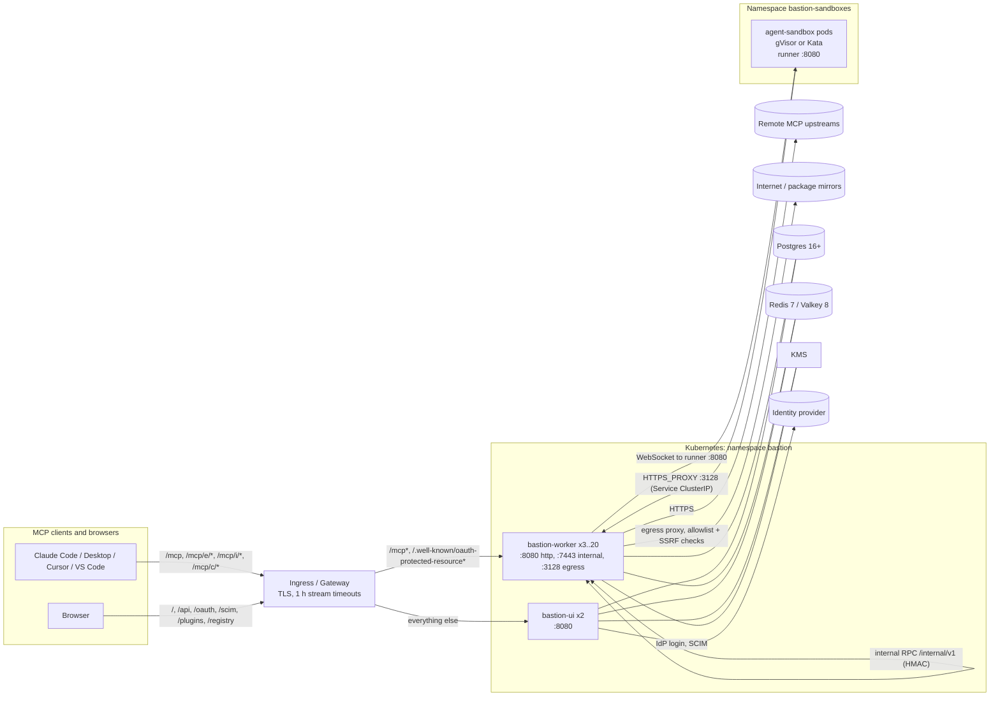
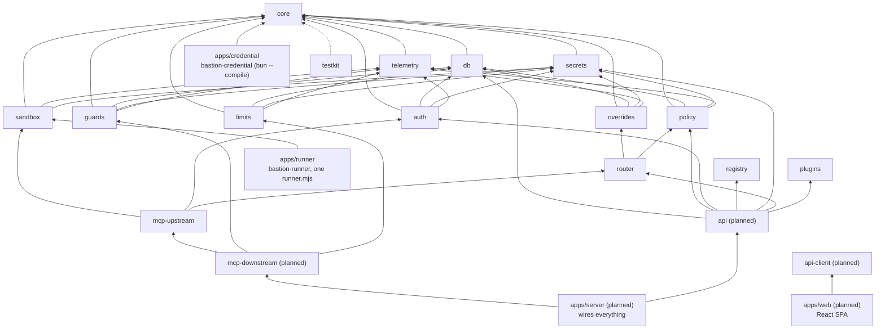

# Bastion architecture

A map for people working on or operating Bastion. The authoritative design is [`tdd.md`](tdd.md); decisions that
differ from it are in [`adr/`](adr/0001-deviations.md); what is built is in [`STATUS.md`](STATUS.md).

## 1. Deployment topology

Two roles ship in one image, selected by `BASTION_ROLE` (4.1, 4.2): `worker` serves the MCP endpoints, owns live
upstream instances, and runs the egress proxy; `ui` serves the SPA, the management API, the embedded OAuth server, SCIM,
the upstream OAuth broker, plugin distribution and the leader-elected scheduler; `all` does both in one process.



All-in-one: one container, every path on 8080, sandboxes through bubblewrap jails inside the container (or the
Kubernetes driver in a cluster with agent-sandbox). Postgres and Redis are always external.

## 2. Package graph (5.3)

`dependency-cruiser` enforces these edges in CI (`pnpm boundaries`); a package imports only the public `src/index.ts` of
what the graph allows. Packages marked "planned" are in the design but not in the repository yet (see `STATUS.md`).



What exists beyond the design's wording: the database layer uses **Prisma 7** instead of Drizzle (ADR 0001, so
`bastion migrate` runs Prisma migrations), and internal packages are consumed as TypeScript source and bundled into
the deployables (ADR 0003). `registry` and `plugins` dependencies are not constrained by 5.3 beyond "`api` may depend on
them".

## 3. Request lifecycle: `tools/call` (4.4)

```mermaid
sequenceDiagram
  autonumber
  participant C as MCP client
  participant W as Worker (receives the request)
  participant R as Redis
  participant O as Owner worker
  participant I as Instance (sandbox runner or remote upstream)
  C->>W: POST /mcp (Authorization: Bearer token)
  W->>W: verify token (JWT via cached JWKS, or PAT SHA-256 lookup)
  W->>W: resolve endpoint, load effective config (cached; 60 s TTL, bastion:config invalidation)
  W->>W: classify era, validate protocol headers against the body
  W->>W: router: github__create_issue to installation + upstream tool, reverse renames, inject pinned args
  W->>W: Cedar authorize callTool for the principal
  W->>R: limits: concurrency, rate, quota
  W->>W: request guards (unicode, size, regex, pii, url, model guards)
  W->>R: read lease:{instanceId}
  alt this worker owns it
    W->>I: call with upstream credential + W3C trace context in _meta
  else another worker owns it
    W->>O: forward over internal RPC :7443 (signed)
    O->>I: call
    I-->>O: result
    O-->>W: NDJSON events, then outcome
  else no instance (cold start)
    W->>R: SET lease NX, start:{instanceId} single-flight
    W->>I: claim sandbox, bind, install, spawn, connect, then call
  end
  I-->>W: result
  W->>W: response guards, index resource links for later resources/read
  W-->>C: result
  W->>W: end span, record metrics, enqueue call-log row (batch 500 ms / 500 rows)
```

Two eras are served on both sides through one internal operation model (6): every operation either completes or returns
*input required* (the MRTR shape of the 2026-07-28 revision); legacy server-initiated requests are converted into that
shape on the way in and back out.

## 4. State and where it lives

| State | Store | Notes |
| --- | --- | --- |
| Configuration, catalog, users, call and audit logs | Postgres | Prisma schema in `packages/db/prisma`; `call_log`, `egress_events`, `distribution_events` are day-partitioned. |
| Secrets (credentials, keyrings, upstream tokens) | Postgres, envelope-encrypted | Data keys wrapped by the KMS (22.3). |
| Sessions, leases, limits, caches, pub/sub | Redis | Key families in 16.3: `lease:`, `workers:`, `egress:`, `uisess:`, `rl:`, `q:`, `guard:`, `risk:`, `logs:`. |
| Effective configuration per (principal, endpoint) | Worker memory | Rebuilt lazily; the hot path never reads Postgres. |
| Live stateful upstreams | One owner worker at a time | Redis lease, 15 s TTL, renewed every 5 s; others forward. |
| Plugin release repositories | ui pod `emptyDir` (`BASTION_GIT_CACHE_DIR`) | Rebuilt deterministically per replica on first request (25.5). |

## 5. Sandboxes (8)

A `SandboxClaim` (`bst-<12 hex>`) against the warm pool `bastion-runtime-<size>` yields a pod running `runner.mjs`; the
worker binds it with a per-claim token, starts the stdio server through the runner's WebSocket framing
(`SandboxStdioTransport`), and keeps traffic flowing through one connection (a new owner replaces it with close code
4001). All sandbox network access goes through the worker's egress proxy, which resolves names once and denies private,
link-local and cluster ranges. The bubblewrap driver gives the same interface with `bwrap` jails and a Unix-socket
egress path per instance.

## 6. Build and release

pnpm workspaces and Turborepo; `apps/server` is bundled by tsdown/esbuild into `dist/main.js` and `dist/otel.js`;
`apps/runner` into `runner.mjs`; `apps/credential` is compiled with `bun build --compile` for five targets. Images, the
Helm chart and the binaries are built and signed by `.github/workflows/release.yml`. Quality gates: `ci.yml` per push,
`nightly.yml` (security, fuzz, kind and gVisor sandbox), `weekly.yml` (load against the targets of 23.4, chaos).
